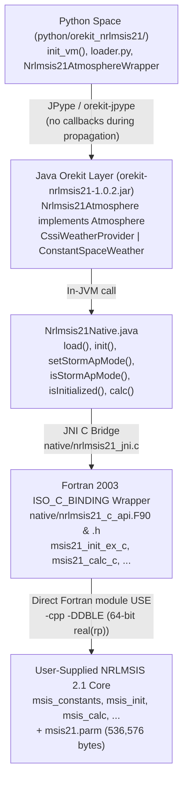

# Architecture of `orekit-nrlmsis21`

`orekit-nrlmsis21` bridges the **NRLMSIS 2.1** Fortran 2003 empirical thermosphere model into the **Orekit** astrodynamics framework so numerical orbit propagators and Batch Least Squares (BLS) orbit determination estimators execute atmospheric density lookups directly inside the JVM process.

> **Upstream Separation Notice:** This document describes the architecture of the `orekit-nrlmsis21` integration layer. In the wrapper-only distribution (`OREKIT_NRLMSIS21_WRAPPER_ONLY=1`), upstream NRLMSIS 2.1 Fortran files, `msis21.parm`, and compiled native shared libraries are supplied locally by the end user under the applicable NRL license.

---

## 1. End-to-End Execution Architecture

---

## 2. Design Rationale Across Layers

### 2.1 Why a Native Bridge Exists
Orekit implements NRLMSISE-00, DTM2000, Harris-Priester, and Jacchia-Bowman 2008 natively in Java, but **does not include NRLMSIS 2.1**. Calling an external Python library (such as `pymsis` or `ctypes`) via a JPype Python proxy inside an Orekit `DragForce` forces every Runge-Kutta / Dormand-Prince ODE substep ($10^5$–$10^7$ evaluations per multi-day propagation or BLS arc) across the JVM $\leftrightarrow$ CPython boundary, introducing serialization latency and GIL contention.

Implementing Orekit's `org.orekit.models.earth.atmosphere.Atmosphere` in Java backed by a direct **JNI $\rightarrow$ Fortran** call keeps the entire propagation and partial-derivative loop inside native/JVM memory space at ~24 µs per scalar evaluation.

### 2.2 Why Fortran `ISO_C_BINDING` Is Used (`native/nrlmsis21_c_api.F90`)
Upstream NRLMSIS 2.1 exposes Fortran 2003 module procedures (`msisinit`, `tselec`, `msiscalc`) with `optional` arguments, assumed-shape arrays, `character(len=*)` strings, and module-parameterized real kind `rp` (64-bit double precision when compiled with `-cpp -DDBLE`). Calling mangled GFortran module symbols directly from C is compiler- and ABI-fragile.

`native/nrlmsis21_c_api.F90` exports six stable `bind(C)` symbols (declared in `native/nrlmsis21_c_api.h`):
- `msis21_init_c(parmpath, parmfile)`
- `msis21_init_ex_c(parmpath, parmfile, storm_ap_mode)`
- `msis21_set_storm_ap_mode_c(storm_ap_mode)`
- `msis21_get_storm_ap_mode_c()`
- `msis21_is_initialized_c()`
- `msis21_calc_c(day, utsec, z_km, lat_deg, lon_deg, sfluxavg, sflux, ap7, out_rho_kg_m3, out_tn_k, out_tex_k, out_dn)`

This layer also performs defensive validation before invoking upstream `msisinit` or `msiscalc`:
- Bounded C-to-Fortran string copying (enforcing upstream's `MAX_MSIS_PATH_LEN = 128` limit and normalizing trailing `/`).
- Pre-validation of `msis21.parm` (exact size `536,576` bytes = `67,072` doubles, all IEEE-754 finite) so corrupted/missing files never trigger upstream Fortran `STOP` or EOF process aborts.
- Per-call zero-initialization of `f_dn`, `f_tn`, and `f_tex` before calling `msiscalc` to prevent stale stack `NaN * 0.0` contamination, plus `ieee_is_finite` and non-negativity checks on all inputs and outputs.

### 2.3 Why JNI (`native/nrlmsis21_jni.c`) & JPype Are Used
- **JNI C Bridge**: Marshals Java primitives, `jstring` paths, and `jdoubleArray` buffers (`ap7`, `outScalars`, `outDn`) directly into `msis21_*_c` under OS mutex serialization without intermediate Python frames. Once loaded via `Nrlmsis21Native.load(...)` during setup, Python never participates in runtime force evaluations.
- **JPype (`orekit-jpype`)**: Standard Python bindings for Orekit run in-process over JPype, allowing `CssiSpaceWeatherData`, `NumericalPropagator`, `DragForce`, and `BatchLSEstimator` to consume `Nrlmsis21Atmosphere` natively.

---

## 3. Data Flow of a Density & Derivative Evaluation

1. Orekit's `DragForce` calls `Nrlmsis21Atmosphere.getDensity(AbsoluteDate date, Vector3D position, Frame frame)`.
2. Inputs are checked for non-null and finiteness (`AbsoluteDate.PAST_INFINITY`/`FUTURE_INFINITY` and `NaN`/`Inf` positions throw `IllegalArgumentException`).
3. `earth.transform(position, frame, date)` computes geodetic coordinates (`altKm`, `latDeg`, `lonDeg`), normalizing longitude via `FastMath.IEEEremainder(lonDeg, 360.0)`.
4. **Domain Policy**:
   - Altitudes `< 0.0 km` are clamped to `MIN_ALTITUDE_KM = 0.0`.
   - Altitudes `> maxAltitudeKm` (default `1000.0 km`) return `0.0 kg/m^3`.
5. `date.getComponents(utc)` yields day-of-year (`1..366`) and seconds of UTC day (`utSec`).
6. `SpaceWeatherProvider` supplies `f107a = getF107Avg(date)`, `f107 = getF107(date)`, and `ap7 = getAp(date)` (`7` finite non-negative elements; `CssiWeatherProvider` delegates directly inside Java to Orekit's `CssiSpaceWeatherData`).
7. `Nrlmsis21Native.calc(...)` acquires the native mutex, invokes `msis21_calc_c(...)` -> `msiscalc(...)`, returns `rho` (`dn(1)` in `kg/m^3`), `tn`, `tex`, and `dn(1..10)`. Any non-zero native status or non-finite/negative density throws `IllegalStateException` (never silently masked as `0.0`).
8. For Orekit `Field` / STM variational equations (`FieldAbsoluteDate<T>`, `FieldVector3D<T>`):
   - `getDensity(...)` computes $\partial\rho/\partial\mathbf{r}$ by central finite differences ($\Delta r = 1.0\text{ m}$ in `frame`).
   - `getVelocity(...)` delegates to Orekit's default `Atmosphere.super.getVelocity(...)`, preserving exact analytical Earth-rotation (Coriolis) partials $\partial\mathbf{v}_{\text{atm}}/\partial\mathbf{r}$.

---

## 4. Initialization, Error Codes, and Ap Modes

### Error & Status Codes
| Code Constant | Value | Meaning |
|---|---|---|
| `MSIS21_SUCCESS` | `0` | Evaluation / initialization succeeded |
| `MSIS21_ERR_NULL_POINTER` | `-1` | Null pointer or undersized Java array (`ap7 < 7`, `outScalars < 3`, `outDn < 10`) |
| `MSIS21_ERR_INVALID_INPUT` | `-2` | Non-finite (`NaN`/`Inf`) or negative solar flux / `ap` input or non-finite output |
| `MSIS21_ERR_INIT_FAILED` | `-3` | Missing, wrong-size (`!= 536576` B), unreadable, or non-finite `msis21.parm`, or path `> 128` chars |
| `MSIS21_ERR_NOT_INITIALIZED` | `-4` | Attempted calculation or Ap-mode toggle before `init` succeeded |

### Storm-Time vs. Daily Ap Mode
- **Storm-Time Ap Mode (`true`, default in `v1.0.2+`)**: Sets `switch_legacy(9) = -1.0`, enabling all 7 elements of Orekit's Ap array (`ap[0]` daily Ap, `ap[1]` current 3-hr Ap, `ap[2..4]` prior 3/6/9-hr indices, `ap[5]` average of `-12..-33` hr, `ap[6]` average of `-36..-57` hr).
- **Daily Ap Mode (`false`)**: Sets `switch_legacy(9) = +1.0` via `tselec` and flushes `msiscalc`'s internal `SAVE` cache (`day = -999.0` dummy evaluation so the next valid call cannot reuse stale cached geomagnetic terms). Uses `ap[0]` only, matching NRL's legacy `gtd8d` reference test driver.

---

## 5. Thread-Safety Strategy & Build Requirements

- **Thread Safety**: Upstream `msiscalc` and `msis_gfn`/`msis_dfn` retain Fortran `SAVE` state (`lastday`, `gf`, `Sz`, etc.). `native/nrlmsis21_jni.c` serializes all `init`, `setStormApMode`, `isStormApMode`, `isInitialized`, and `calc` calls using:
  - **Windows**: Race-free `INIT_ONCE` (`InitOnceExecuteOnce`) + `CRITICAL_SECTION`.
  - **Linux**: Statically initialized `pthread_mutex_t` (`PTHREAD_MUTEX_INITIALIZER`).
- **Build Requirements**:
  - `CMake >= 3.20` and `Ninja` (or `Make`)
  - `gfortran` and `gcc` (GNU GCC/GFortran 10+, tested with 15.2.0); flags `-cpp -DDBLE -O3 -fPIC`
  - **Windows**: MSYS2 UCRT64 64-bit MinGW-w64 toolchain (`-static -static-libgcc -static-libgfortran`)
  - **JDK 17+** (`JAVA_HOME` with JNI headers `jni.h`)
  - **User-supplied upstream directory**: 8 unmodified NRLMSIS 2.1 `.F90` files passed via `-DNRLMSIS21_SOURCE_DIR=<path>` (defaults to `external/NRLMSIS2.1` in local development checkouts).

---

## 6. Separate-Wrapper Acquisition Workflow (`pymsis`-Inspired)

To keep the public repository and wrapper distributions free of NRL-owned source code and binaries:
1. `python/orekit_nrlmsis21/acquire.py` validates an existing local directory (`--verify`), safely extracts a user-downloaded NRL archive (`--from-archive`), or downloads from `https://map.nrl.navy.mil/map/pub/nrl/NRLMSIS/NRLMSIS2.1/nrlmsis2.1.tar.gz` **only after explicit interactive `"YES"` confirmation** (`--download`) without ever overwriting existing user files.
2. `CMakeLists.txt` accepts `-DNRLMSIS21_SOURCE_DIR=<path>`, verifies all 8 `.F90` files and module declarations at configure time, and compiles `.mod` files into an isolated binary tree (`Fortran_MODULE_DIRECTORY`).
3. `python/orekit_nrlmsis21/loader.py` resolves `NRLMSIS21_LIB_PATH` and `NRLMSIS21_PARM_PATH` (`536,576`-byte validation) at runtime with fail-fast errors when unconfigured or invalid.

## 7. Component-Level Licensing & Derivative Status (Unresolved)

See [`../PUBLICATION_MANIFEST.md`](../PUBLICATION_MANIFEST.md) and [`../RELEASE_BLOCKERS.md`](../RELEASE_BLOCKERS.md) for complete classification and open legal blockers. Using **Apache-2.0** for independently authored wrapper components is currently a **candidate approach, NOT an approved final legal decision**.

| Component | Repository Path | Classification & Legal Status |
|---|---|---|
| **Python Wrapper & Acquisition CLI** | `python/orekit_nrlmsis21/*.py` | **Category A** — Independently authored; permissive license (`Apache-2.0` candidate, pending final decision); no NRL source bundled. |
| **Java Orekit Adapters** | `java/src/main/java/org/ssa/nrlmsis21/*.java` | **Category A** — Independently authored (`Apache-2.0` candidate); zero NRL code (`Nrlmsis21Native` defines JNI boundary into Category B). |
| **C JNI Bridge** | `native/nrlmsis21_jni.c` | **Category B** — Project-authored C source including `nrlmsis21_c_api.h`, locally compiled and linked with Fortran objects into one shared library. Independent distribution status awaits NRL clarification. |
| **Fortran `ISO_C_BINDING` C API** | `native/nrlmsis21_c_api.F90`, `.h` | **Category B** — Directly `USE`s NRL modules (`msis_constants`, `msis_init`, `msis_calc`). **`NRL-SOF-014-1` Section 4(b) derivative-work status awaits written NRL Code 7630 clarification (not legally cleared).** |
| **Upstream NRLMSIS 2.1 & `msis21.parm`** | User-supplied locally (excluded) | **Category D / Category C notice** — Property of U.S. Government (**`NRL-SOF-014-1`**): **non-commercial research, academic, and non-profit use only**. |
